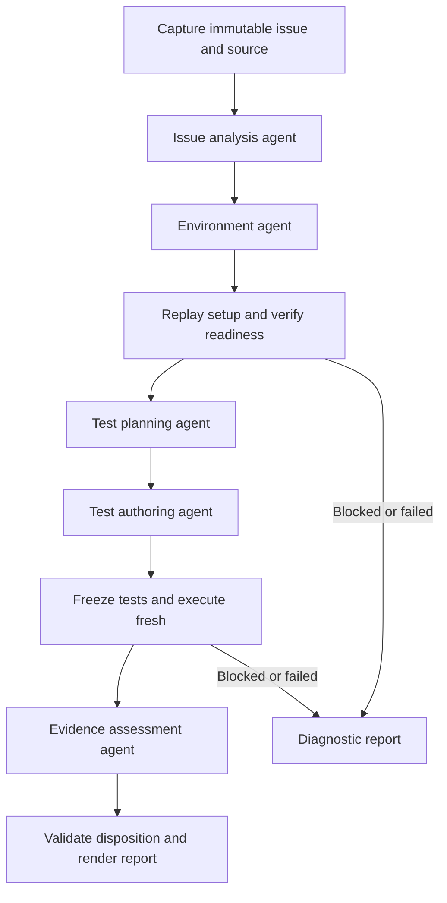

# Architecture and component boundaries

The system uses a fixed graph of five PydanticAI agents plus deterministic nodes. Temporal owns durable coordination. Agents do not select their successors or allocate additional authority.

## Graph



Every node has explicit success, blocked, unsupported, failure, and unknown outcomes as applicable. Other node failures also enter finalization with their diagnostic evidence. Cleanup runs independently of report interpretation. Bounded corrections occur within an agent's stage; they do not create unrestricted graph loops.

## Agent contracts

| Agent | Objective and output | Authority |
| --- | --- | --- |
| Issue analysis | Testable hypothesis, source citations, preconditions, scope | Confined source/issue reads only |
| Environment | Successful setup recipe, dependency closure, environment evidence | Preparation sandbox commands and approved setup artifacts; no application changes or policy edits |
| Test planning | Two-test specification and evidence requirements | Source and environment evidence reads only |
| Test authoring | Exactly two native tests, test patch, run command | Approved test writes and bounded development execution in the prepared environment |
| Evidence assessment | Interpretation, citations, limitations, proposed disposition | Frozen execution and source evidence reads only |

All agents use separate contexts and receive only explicit stage inputs. No global conversation or shared mutable agent memory is required. Budgets and permissions are injected dependencies, not instructions that an agent can override.

Agent factories, output contracts, prompts, and toolsets are reused in direct and durable execution. Production graph stages use small child workflows beneath one parent investigation workflow. Native PydanticAI Temporal capabilities route model and tool operations through activities. The complete agent loop must not be wrapped in one opaque retryable activity.

## Deterministic responsibilities

Deterministic nodes acquire snapshots, resolve revisions, enforce support, replay setup, verify native discovery, freeze test artifacts, execute tests, collect receipts and policy events, validate conclusions, render reports, and manage cleanup. Their checks establish execution facts; model prose cannot override them.

Environment readiness requires a relevant build and a discovered, executed baseline test or admitted native control fixture. An existing unrelated suite failure is retained and assessed; it is not silently hidden or automatically equated with environment failure.

## Ports and adapters

| Port | Contract | First implementation and extension |
| --- | --- | --- |
| Sandbox | Lifecycle, files, command results, boundary observations, cleanup | OpenShell SDK; fixture/local execution for development; another qualified backend later |
| Model selection | Supply a configured PydanticAI model and capability requirements | Native local OpenAI-compatible provider or native Bedrock provider |
| Issue | Immutable finding and discussion snapshot | Supported GitHub client; Azure DevOps work-item adapter later |
| Source | Resolve and acquire an exact source identity | Git acquisition without executing repository hooks |
| Artifacts | Store/read immutable objects by authorized reference and digest | Standard filesystem on persistent storage; object-storage SDK later |

Use SDK types inside adapters; keep stage contracts free of vendor SDK objects. The model boundary is a small composition/factory seam, not a new model-request protocol. Preserve backend-specific diagnostic evidence and reject unsupported required capabilities explicitly. No automatic provider or sandbox fallback is allowed.

## Deployment

The local kind deployment and existing-cluster deployment use the same application chart, images, graph, and adapters. Environment values select image registries, resource limits, storage, provider access, and external access.

Start with one worker deployment, one active investigation, a Temporal service, an OpenShell gateway, and persistent artifacts. Local Temporal may use a supported development configuration with persistent state; production uses an operator-provided qualified service and database configuration. Do not operate a second application job ledger.

Application resources are namespace-scoped. OpenShell's Agent Sandbox controller/CRDs, cluster RBAC requirements, NetworkPolicy enforcement, and node/kernel support are platform prerequisites. Local bootstrap provisions the selected prerequisites; an existing cluster's platform team supplies them. Qualification tests actual enforcement, not just resource creation. Namespace isolation does not establish isolation from a compromised node; dedicated nodes or stronger runtimes remain a platform qualification decision.

The trusted worker owns model access and sandbox lifecycle. Repository workloads have no model, issue-provider, cloud, or cluster-management credentials. Configure untrusted workload service accounts without automatic credential mounting. Restrict sandbox-to-control-plane communication according to the supported OpenShell topology.

## Organization

```text
src/validator/
  core/                 contracts, evidence rules, verdict gates
  ports/                narrow external capability interfaces
  adapters/             SDK-backed implementations
  agents/
    issue_analysis/
    environment/
    test_planning/
    test_authoring/
    evidence_assessment/
  workflows/            Temporal graph and agent stage workflows
  composition.py        explicit adapter and agent wiring
  cli.py                thin diagnostic and evaluation entry points
evals/                  cases, reviewed labels, evaluators, baselines
tests/                  deterministic, adapter, integration, replay tests
images/                 approved toolchain images
policies/               operator-owned sandbox profiles
deploy/                 chart, kind config, environment values
docs/                   contracts, qualification evidence, runbooks
```

Each agent owns its factory, contracts, instructions, tools, and evaluation cases. Share a capability only when there is a demonstrated second consumer. Ports describe external capabilities; avoid interfaces for every internal function.

## Complexity rules

Use PydanticAI for loops, outputs, limits, providers, overrides, and instrumentation; Temporal for history, retries, timeouts, cancellation, and replay; OpenShell for sandbox mechanics; and Pydantic Evals for evaluation execution and reports.

Application-specific code is limited to stage contracts, restricted domain tools, evidence interpretation/gates, SDK translation, and composition. Do not build another scheduler, tracing system, provider protocol, credential broker, generic graph engine, or agent simulator. Additional agents, services, repair loops, or shared state require a concrete failing case, named owner, and measured benefit.

Use explicit Temporal transitions as the graph execution authority. Adding a graph library is unnecessary unless it improves implementation without duplicating durable state or scheduling.
