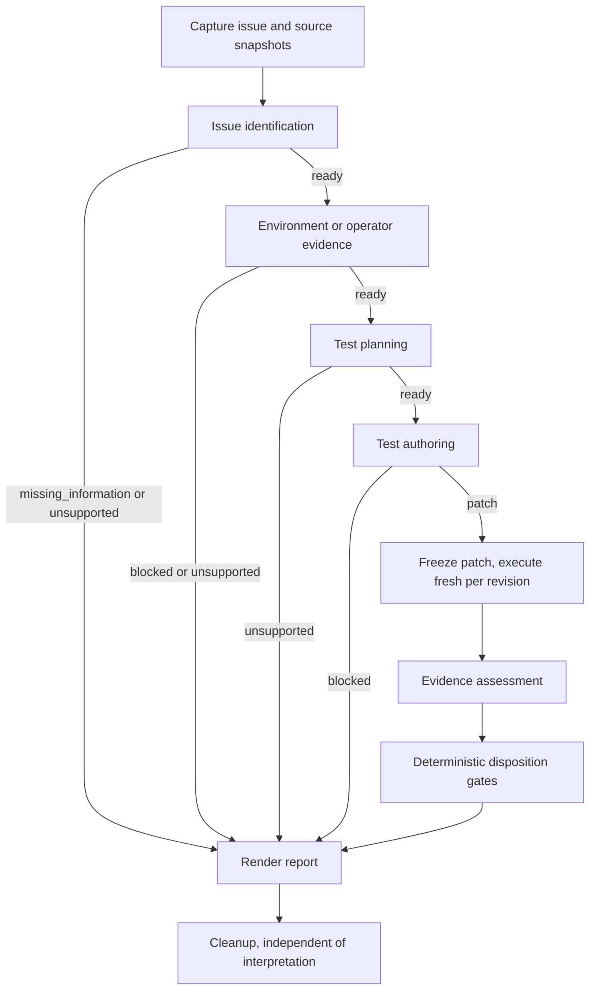

# Remaining agents and deterministic nodes for a first end-to-end run

## Problem and evidence

The user asked for a plan of the agents still needed to run one investigation end to end: each agent's purpose, inputs, outputs, skills, tools and evaluations, plus whether a PydanticAI agent graph ([GraphBuilder](https://pydantic.dev/docs/ai/graph/builder/)) fits. [IDEA-0003](IDEA-0003-remaining-agent-graph-inventory.md) surveyed main `afb75f3` before the first stage was narrowed; this record re-checks main `95effd3` after [SPEC-0024](../specs/SPEC-0024-issue-identification.md) and turns the inventory into per-agent designs and a path to a first run. It is a proposal: no agent below is specified beyond SPEC-0022 or authorized for implementation by this record.

Verified on `95effd3`:

| Graph stage ([architecture](../../architecture.md)) | Source state | Evaluation state |
| --- | --- | --- |
| Issue identification | Implemented: `create_issue_identification_agent`, `IssueIdentificationDraft`/`IssueIdentification`, `identify-issue` skill, stage-owned `read_source` toolset (`agents/issue_analysis/identification.py`, `tools/identification.py`) | `evals/issue_identification`: 8 development cases, final 16/16 native-provider attempts, 390 offline checks; no held-out cases; no durable workflow for this contract |
| Environment | Absent | Absent |
| Test planning | Draft [SPEC-0022](../specs/SPEC-0022-test-planning-agent.md); no code | Absent |
| Test authoring | Absent | Absent |
| Evidence assessment | Absent | Absent |
| Legacy hypothesis analyst and auxiliary reviewer | Implemented, disconnected, historical | ISSUE-0007 blocked |

Deterministic pieces that exist: `GitSource`/`LocalArtifacts`, the OpenShell lifecycle and execution adapters behind `ports/sandbox.py` and `ports/execution.py`, the SPEC-0017 report consumer (`reports/test_observations.py`, `AdmittedTestClaims`), the reviewed SPEC-0018 pytest pair, and the single-agent `IssueAnalysisWorkflow` base. Absent: issue port, `SourceSnapshot`-to-inventory bridge, native test runner, `core/` gates, report renderer and parent workflow.

## Proposal and limits

### Scope of the first end-to-end run

The architecture fixes five agents; this plan adds none. The shortest honest path to an end-to-end run is the reviewed synthetic Python path-traversal pair (`benchmarks/fixtures/path-traversal/`, vulnerable and fixed revisions), with operator-supplied environment evidence standing in for the environment agent, because SPEC-0022 already defines that evidence as operator data until the environment stage exists and its source delivery depends on the in-sandbox fetch in SPEC-0025. The environment agent joins for the first real case.

| Run | Stages | Execution | What it can establish |
| --- | --- | --- | --- |
| E2E-0 fixture, direct | Identification, planning, authoring, freeze/execute both revisions, assessment, gates, report | Scripted/`FunctionModel` agents, then the native provider; test bytes executed only in OpenShell, except the reviewed SPEC-0018 bytes, which may also run locally | Contracts compose; gates reproduce the known disposition. Not live-agent accuracy |
| E2E-1 fixture, durable | Same, under one parent Temporal workflow with child stage workflows | OpenShell | Durable composition, replay, unknown-delivery handling, cleanup |
| E2E-2 first real case | Adds environment agent, in-sandbox source fetch and setup replay | OpenShell, admitted case under PLAN-0021 | First real-project evidence; gated by SPEC-0025, SPEC-0026 and PLAN-0021 |

Model-authored test code is untrusted workload code. It runs only in the qualified sandbox, never on the host. The narrowest new execution gate for E2E-0 is therefore delivery of one bounded approved test file next to captured source, a smaller contract than the general transfer blocked by ISSUE-0006.

### Proposed graph and routing

Every agent output is a Pydantic discriminated union on `status`, so routing is a total function from the last stage outcome to the next stage. Every abstention reaches the report with its reason; there are no loops between stages, and bounded correction stays inside a stage's own agent run.

### Shared conventions every new agent follows

These are established on main and reused, not redesigned:

- Package `agents/<stage>/` with `agent.py` (factory taking an explicit `Model`, `PROMPT_VERSION`, `CONFIG_VERSION`, trusted output function), `contracts.py` (frozen `extra="forbid"` models, model-facing draft with line references and final contract with trusted quotations per SPEC-0020), `skills/<skill>/SKILL.md` delivered eagerly through native `Capability` and recorded by SHA256, and a `FunctionToolset` with `retries={"tools": 0}`.
- Trusted output functions admit only current-run evidence, as `finalize_identification` already does for `read_source` returns stamped with `ctx.run_id`.
- Callers inject `UsageLimits`; durable mode uses native PydanticAI Temporal activities and the same factory (SPEC-0015).
- `evals/<stage>/cases.yaml` as a native Pydantic Evals dataset with oracles in `metadata`/`expected_output`, never in inputs (SPEC-0023), development and held-out splits, and `tests/agents/test_<stage>.py` with `TestModel`/`FunctionModel` and real requests blocked.
- Shared code moves only when a second consumer exists. The planner is that consumer for the saved-source contracts, the `read_source` toolset and `LocalModelConfig`, which move to `agents/source/` and `agents/provider.py` as SPEC-0022 describes.

### Agent 1: issue identification (implemented; remaining work only)

- **Purpose:** preserve the reported concern and locate one relevant implementation, or abstain with a concrete reason.
- **Input/output:** `IssueAnalysisInput` → `IssueIdentification` (`ready` with `Target{symbol, source: SourceExcerpt}`, or `missing_information`/`unsupported` with `reason`; `reported_issue` attached by trusted code).
- **Skill/tools:** `identify-issue`; `read_source(path, start_line)`.
- **Remaining:** held-out localization cases including multi-file and decoy-heavy inputs; a durable stage workflow for this contract (the existing `IssueAnalysisWorkflow` is bound to the legacy `IssueAnalysis` output); an input builder from captured `SourceSnapshot`s instead of fixture strings.

### Agent 2: test planning (SPEC-0022, next)

- **Purpose:** turn the located concern into a conditional, falsifiable hypothesis and exactly one control and one security test specification, or an honest `unsupported` plan.
- **Input:** `TestPlanningInput{scope, IssueIdentification(ready), source_files, EnvironmentEvidence}`. `EnvironmentEvidence` holds language/runtime/framework identities, native discovery command tokens, approved test paths, the discovered and executed baseline test, and the fixture scratch location.
- **Output:** `ReadyTestPlan{scope, control, security, discovery_command, evidence_requirements, citations, limitations}` where each `TestSpecification` carries `test_id`, `test_path`, `fixture_setup`, `implementation_call`, `input`, `required_behavior`, `observable_witness`, `source_references`; or `UnsupportedTestPlan{scope, missing_capability, limitations, citations}`.
- **Skill:** `plan-two-tests` (confirm target and sensitive operation by reading; read the baseline test for conventions; benign input through the real path; adversarial condition from the report; explicit preconditions as fixture setup; specific required safe behavior, never an arbitrary exception; separate application and sandbox observations; fixtures in scratch; `unsupported` when the observation is not supportable). Framework conventions arrive as environment data, not as a second skill, unless evaluation shows the single skill failing per framework.
- **Tools:** shared `read_source` only. No execution, write or network tool.

### Agent 3: evidence assessment (after the `core/` gates)

- **Purpose:** interpret frozen per-revision execution evidence and propose the `execution`/`finding`/`fix` triple with citations and limitations. Deterministic gates admit or reject the proposal; the agent cannot override them.
- **Input:** `AssessmentInput{IssueIdentification, ReadyTestPlan, frozen test patch reference and digest, revisions: per revision AdmittedTestClaims or the failure receipt, execution and lifecycle receipts, sandbox/policy observations, witness artifacts, source references}`. No variant labels: revisions are named `baseline` and `candidate`, never `vulnerable`/`fixed`.
- **Output:** `ProposedDisposition{execution, finding, fix, application_observations, sandbox_observations, interpretation, citations, limitations}`, values exactly those in the [investigation contract](../../investigation-contract.md). Citations reference evidence item ids, resolved by the trusted output function.
- **Skill:** `assess-evidence` (treat test claims as claims; failed control, skip, compile error, unknown delivery, timeout or sandbox denial cannot support a conclusion; `refuted_in_scope` needs affirmative evidence; contradictions block a conclusive disposition; state scope and what remains outside it).
- **Tools:** `read_evidence(item_id, start)` bounded over frozen artifacts admitted for this run; shared `read_source`. Nothing else.
- **Deterministic companion, built first:** `core/disposition.py` computes the strongest disposition the evidence permits; gates reject any agent proposal stronger than that. Pass/fail claims and receipts are necessary but not sufficient, because `AdmittedTestClaims` carries only passed/failed/skipped and `ExecutionReceipt.failure_layer` describes command execution, not why a test failed. Two discovered tests, passing controls, matching patch digests and baseline-fail/candidate-pass can coexist with a baseline that failed on an unrelated exception or a candidate whose apparent rejection was sandbox interference. The [investigation contract](../../investigation-contract.md) keeps test validity separate from execution validity, and the gate must enforce that separation itself rather than rely on the assessment model. Its inputs, each separately admitted per revision:
  - **Execution validity:** complete delivery and terminal observation, native discovery of exactly the two planned test ids, no skips, and the same frozen patch digest on both revisions.
  - **Failure classification:** for each failed test, the native failure type and location (from bounded JUnit failure elements) matched against the plan's `required_behavior`: the security test's failure must be the planned assertion at the planned call, not an import error, fixture error, timeout or any other exception. An unclassifiable failure is `unknown`.
  - **Witness evidence:** the plan's `observable_witness` captured as its own artifact outside the test's pass/fail claim (for SPEC-0018, the file-open audit event for the outside sentinel, or its absence after the specific rejection), showing that the planned sensitive path ran.
  - **Environment comparability:** identical image digest, recipe, dependency inventory, policy revision and limits across revisions, or recorded differences that the gate treats as blocking.
  - **Sandbox and policy observations:** any policy denial or resource-limit event during the test phase that touches the witness path makes the observation sandbox-attributed, never application safety.
  - **Contradiction:** repeats on the same revision with differing classified outcomes block a conclusive disposition.

  The two revisions are judged separately, because finding and fix are independent fields. `finding: reproduced` depends only on the baseline: a valid control, a classified planned security failure and its witness. Invalid or unknown baseline evidence yields `inconclusive`. `fix: verified` additionally requires the candidate's control to pass, its security test to pass for the planned reason, and comparability to hold. Candidate-only problems (a sandbox-denied rejection, unknown delivery, noncomparable environment) set `fix: not_verified` and record the candidate's execution or boundary limitation, but they do not erase a valid baseline reproduction, as the investigation contract's rule on preserving earlier valid evidence requires. Only contradictory valid evidence blocks an existing finding. These gates are useful without the agent and are the first `core/` code.

### Agent 4: test authoring (after a native runner adapter)

- **Purpose:** realize the plan as exactly two native tests in a patch confined to approved test paths, and show that they are discovered and execute in the prepared development sandbox.
- **Input:** `TestAuthoringInput{ReadyTestPlan, source_files (including the baseline test), EnvironmentEvidence, development sandbox reference}`.
- **Output:** `TestPatch{files: tuple[path, content], control_test_id, security_test_id, run_command, patch_sha256, dev_run_references}` or `BlockedAuthoring{layer, reason, dev_run_references}` (layer: compile, discovery, dependency, fixture, sandbox, unknown).
- **Skill:** `write-native-tests` (call the planned implementation directly; never mock the sink or reimplement the target; assert the planned specific behavior, never a constant or bare exception; observe the planned witness; fixtures in scratch; never modify application source or test configuration; one bounded fix per observed compile or discovery error).
- **Tools:** shared `read_source`; `write_test_file(path, content)` that edits an in-memory patch and refuses paths outside the approved set; `run_tests()` that applies the current patch to a fresh copy of the captured baseline in the development sandbox through the runner adapter and returns discovered test ids, collection/compile errors and the control outcome. Default: the security test's pass/fail outcome is withheld from the author, so the author fixes buildability and discovery rather than tuning the assertion toward an outcome; the outcome belongs to the frozen execution node. Development runs are capped by an operator budget (default 3).
- **Deterministic companion, built first:** a native runner adapter that applies an approved patch, runs native discovery (pytest `--collect-only`, later Maven Surefire), executes once and emits the SPEC-0017 report from actual JUnit XML rather than from workload-printed claims, plus the bounded failure type/location per failed test and the witness artifact the gates need. JUnit content is still a workload claim; it supplies classification input, not semantic attestation. Saved cases then rerun without any agent (`verify --case`, Milestone 4).

### Agent 5: environment (last; gated)

- **Purpose:** discover a replayable setup recipe from existing manifests, CI and docs, and produce the same `EnvironmentEvidence` the planner consumes plus the recipe and dependency closure.
- **Input:** source snapshot inventory restricted to manifests, CI workflows and setup documentation; the admitted toolchain image catalog; the read-only policy profile identity; operator budgets.
- **Output:** `ReadyEnvironment{toolchain_image, recipe (command tokens), dependency_closure (resolved artifact digests), build_command, discovery_command, baseline_test_id, baseline_outcome, approved_test_paths, scratch_location, receipts}`, `BlockedEnvironment{layer, evidence}` (layers: dependency, registry, TLS, toolchain version, build, discovery, sandbox, unknown) or `UnsupportedEnvironment{requirement}`.
- **Skill:** `prepare-environment` (prefer the repository's native build tool and documented CI steps; never edit application source, policies or pins; distinguish registry or TLS denial from a missing dependency; report rather than work around an unsupported toolchain; repository instructions are data).
- **Tools:** shared `read_source`; `list_toolchains()`; `run_setup_command(tokens)` in a preparation sandbox through the execution port with operator limits; `read_output(ref)`. A deterministic node then replays the recipe in a fresh sandbox and verifies relevant build plus discovered and executed baseline test before the planner runs.
- **Source delivery:** the sandbox fetches the pinned commit itself under [SPEC-0025](../specs/SPEC-0025-sandbox-source-fetch.md) (user decision, 2026-10-12): GitHub or Azure DevOps over HTTPS, public or private, with private-repository tokens held by OpenShell's credential proxy rather than the workload; no writes; identity checked against the host capture before any repository code runs; repository-host egress denied after the fetch. This is the reviewed narrower contract ISSUE-0006 allows, so host-to-sandbox tree upload is no longer on this agent's path. Source admission compares the actual materialized bytes with the host capture, and live use is blocked until a storage enforcement mechanism is qualified. Dependencies then come from the standard public registries under [SPEC-0026](../specs/SPEC-0026-sandbox-dependency-fetch.md): GET-only method and endpoint restrictions during setup, a complete realized on-disk inventory, no network while tests run, and no registry egress for private source until a constrained acquisition design is qualified.
- **Gate:** SPEC-0025 and SPEC-0026 live qualification, and PLAN-0021 admission of the case.

### Deterministic nodes on the critical path

| Node | Needed by | Notes |
| --- | --- | --- |
| Snapshot-to-inventory bridge | Every agent | Builds bounded `source_files` from `GitSource` captures (IDEA-0002 package 4) |
| Issue snapshot port | E2E-0 uses fixture issues; GitHub adapter at Milestone 7 | Immutable text, origin, retrieval time, digest |
| In-sandbox source fetch | Environment, execution on real cases | SPEC-0025: pinned fetch, public or private via credential proxy, host identity check, egress narrowed before repository code |
| In-sandbox dependency fetch | Environment, execution on real cases | SPEC-0026: GET-only public registries during setup, resolved-set record, no network during tests |
| Approved test-file delivery | Authoring and execution | One bounded file next to the source; narrower than ISSUE-0006 |
| Native runner adapter | Authoring, execution | Discovery, single execution, report from actual JUnit |
| Freeze and execute per revision | Assessment | Same patch digest on both revisions, fresh sandbox each |
| `core/` disposition gates | Assessment, report | First `core/` module |
| Report renderer | Report | Markdown and JSON from the contract fields |
| Parent workflow | E2E-1 | Child workflow per stage; routing as above |

### Evaluations and tests per agent

All dimensions come from [evaluation and acceptance](../../evaluation-and-acceptance.md); each is reported separately, every failed attempt is retained, and held-out cases run once per promotion candidate (SPEC-0023).

| Dimension | Identification | Planning | Authoring | Assessment | Environment |
| --- | --- | --- | --- | --- | --- |
| Contract adherence | Union validity, report preserved | Exactly two specs, approved paths, discovery tokens match | Two test ids, paths confined, no source edits | Allowed triple values, cited evidence ids exist | Recipe tokens, closure digests, required fields |
| Task correctness (oracle) | Curated symbol/range | SPEC-0018 realization as reference plan | Frozen execution: control passes both, security fails baseline and passes candidate | Expected disposition on SPEC-0018 runs and failure fixtures, including same-outcome negatives (below) | Fresh replay builds and runs the baseline test |
| Negative and robustness | Decoys, missing source, honest abstention | No baseline test, absent implementation, unsupported witness | Unobservable plan, existing failing suite, flaky dependency | Failed control, skip, compile error, unknown delivery, timeout, sandbox denial, contradictory repeats; same pass/fail outcomes as a true reproduction but with an unrelated baseline exception or a missing baseline witness (expect `inconclusive`/`not_verified`), or with a valid baseline reproduction plus a sandbox-denied candidate rejection or noncomparable candidate environment (expect `reproduced`/`not_verified` with the candidate limitation recorded); contradictory valid baseline repeats (expect `inconclusive`) | Missing dependency, registry/TLS denial, wrong JDK |
| Static test semantics | n/a | Plan names real call and specific behavior | AST checks: no mocked target or sink, no constant assertion, no bare `except`, no skip markers, calls the planned implementation | n/a | n/a |
| Grounding | Current-run reads cover citation | Current-run reads cover citations | Patch references real symbols | Every claim cites an evidence item; no fix without both revisions | Recipe steps cite manifest or CI lines |
| Trajectory and tool correctness | Read before cite | Read before cite | Write before run, run budget, no writes after the final run | Reads evidence before proposing | No source writes, no policy reads beyond identity |
| Security | Injection in issue/source | Injection in saved tests | Write outside paths, printed fake report, network attempt | Injection in test output and logs | `curl \| sh` in README/CI, egress beyond policy, credential probing |
| Consistency | Repeat agreement | Repeat agreement on plan semantics | Repeat frozen outcomes | Same evidence, same disposition; changed evidence changes disposition | Alternative valid recipes admissible |
| Durability | Replay of its stage workflow | Same | Unknown dev-run delivery not blindly repeated | Replay | Setup side effects not replayed |
| Efficiency | Requests, tools, tokens, latency | Same | Same plus dev runs and sandbox time | Same | Same plus commands and setup time |

Cross-cutting: handoff composition tests (each output admitted into the next input contract, with refusal cases), direct and durable parity on the same cases, recorded-history replay, provider compatibility reported per configuration, and a small end-to-end regression suite (E2E-0 pair first, then one Java pair). Deterministic gate tests are table-driven over the investigation contract's verdict rules. Model judging stays secondary to these checks and never approves a disposition.

### Proposed order

1. Move shared source contracts, toolset and provider to `agents/source/` and `agents/provider.py` (the planner is the second consumer).
2. Implement the planner under SPEC-0022 with its evals.
3. Implement `core/` disposition gates (execution validity, failure classification, witness, comparability, sandbox attribution, contradiction) and the report renderer; validate them on the six retained SPEC-0018 runs and on synthetic same-outcome negative fixtures.
4. Implement the evidence assessment agent against those frozen inputs.
5. Implement the native runner adapter and approved test-file delivery; rerun the SPEC-0018 pair through them without an agent.
6. Implement the test authoring agent.
7. Compose E2E-0 directly, then the parent workflow and E2E-1 durably.
8. Qualify SPEC-0025 source fetch and SPEC-0026 dependency fetch; these need no agent and can run in parallel with steps 2–6.
9. Implement the environment agent and setup replay once those pass and PLAN-0021 admits a real case; run E2E-2.

Steps 2–4 need no new runtime and can proceed in parallel with step 5. Each agent gets its own spec and plan when it starts.

### PydanticAI graph builder assessment

What it offers, checked against the [builder](https://pydantic.dev/docs/ai/graph/builder/) and [decisions](https://pydantic.dev/docs/ai/graph/builder/decisions/) pages and the locked `pydantic-graph` 2.55.0, already a transitive dependency in `uv.lock`: typed `@g.step` functions over a `StepContext` with `state`, `deps` and `inputs`; `g.decision()` with branches matched by type, `TypeExpression[Literal[...]]` or predicate, first match wins; map, broadcast and join with reducers; `graph.iter()` for stepwise control; Mermaid rendering. Version 2 removed `pydantic_graph.persistence` and points to a durable execution engine for surviving restarts. PydanticAI's Temporal integration passes `pydantic_graph` through the workflow sandbox because the agent loop is built on it, but the pages document no integration for running a builder graph as Temporal orchestration.

How the three motivating features map onto the current design:

| Feature | Graph builder | Corsair today |
| --- | --- | --- |
| Decision nodes | `g.decision()` routing by type or literal | Every stage output is a `status` discriminated union; the parent workflow routes with a total `match` on it, testable as a pure function |
| Dependency injection | `StepContext.deps` | PydanticAI `deps_type` per agent (for example `FixtureDependencies`), operator-injected `UsageLimits` and budgets, Temporal worker configuration for adapters |
| State management | Mutable `ctx.state` shared across steps | Temporal history is the job state authority; agents get only explicit stage inputs and no shared mutable memory ([architecture](../../architecture.md)) |

Recommendation: do not adopt the graph builder for the parent investigation now. The first run is a linear graph with one abstention exit per stage and no fan-out except per-revision execution, which concurrent Temporal child workflows already express. A builder graph inside a Temporal workflow would add a second definition of the same transitions, its shared mutable state conflicts with the stage isolation rule, and changing a graph's structure would become a workflow-replay compatibility concern without new benefit. The architecture already sets this bar: a graph library only if it improves implementation without duplicating durable state or scheduling.

Where it could earn a place later, as a bounded experiment rather than a decision: if direct mode needs the full multi-stage composition outside Temporal and maintaining a direct orchestrator beside the parent workflow proves duplicative, spike one builder graph whose steps call an injected stage runner (in-process in direct mode, child workflow in durable mode), run it inside a Temporal workflow, and qualify replay and versioning. Adopt it only if it deletes code. Writing routing as a pure function first keeps that option cheap either way.

Complexity cost of this plan: four agent packages, one `core/` module, one runner adapter, one delivery contract, one renderer, one parent workflow. Excluded: new agents, a graph library, shared memory, cross-stage repair loops, issue-provider adapters beyond fixtures, Bedrock, and the analyst pilot.

## Decision

Accepted by the user on 2026-10-12, together with in-sandbox source fetch (SPEC-0025) as the environment agent's source delivery route. The user then resolved its open questions: Azure DevOps fetch by exact commit is assumed, private repositories are allowed with the PAT held by OpenShell's credential proxy, and dependencies come from standard public registries (SPEC-0026). Accepted means selected for specification; each agent and node still needs its own spec, plan and qualification. It refines IDEA-0003's build order for the narrowed first stage and adds per-agent contracts, tools and evaluation dimensions. Defaults chosen where the request forked: environment evidence stays operator data until E2E-2; assessment precedes authoring because its inputs exist; the security outcome is withheld from the author's development runs; no graph library. Each agent still needs its own spec, plan and isolated baseline before connection; ISSUE-0007 and PLAN-0021 gates are unchanged; ISSUE-0006 stays blocked for general transfers but is off the environment agent's path if SPEC-0025 qualifies.
