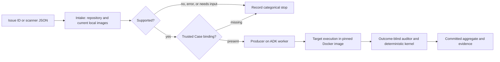

# Agentic issue intake

The optional intake agent accepts one issue reference or bounded arbitrary scanner JSON, inspects the admitted repository without running its code, and classifies requirements against reviewed, configured Docker images currently available locally. It adds a front end to main's existing evidence runner. It does not replace the payload-pair contract, target binding, coverage checks, independent auditor, negative thresholds, runtime drivers or six verdicts.

## Run the connected workflow

Use `investigate BINDING_REQUEST --json ISSUE_JSON --settings SETTINGS --wait` (or replace `--json` with an allowlisted `--issue`) to run the whole workflow. `intake-agent` alone stops after inspection; `investigate REQUEST` without issue flags retains the existing direct Case route.



After admission, image selection and stage transitions are automatic. The selected immutable image ID is carried through the prepared producer input and used for every target container, including optional fixed-source execution. An unrelated default image is not required for pinned runs. Changing or losing the selected image blocks execution; there is no default substitution or pull.

The producer's model runs on the ADK worker; the target and trusted observer run inside Docker. A trusted operator-owned Case binding is still required. Intake does not create the observer, callable arguments or trusted assertion from an arbitrary report. Without that binding the workflow stops as `TARGET_BINDING_REQUIRED`, so this is not an arbitrary-issue-to-unbound-execution service.

A live test now exercises the normal CLI and production worker with Qwen for intake, producer and auditor, a deliberately unavailable default, and native receipts bound to intake's selected image. It also checks the out-of-scope, unsupported and missing-binding stops. This qualifies the stated known Python fixture path, not general scanner reliability; the contradictory-report classification defect remains [open](../plans/active/ISSUE-0001-intake-conflicting-reports.md). See the [live end-to-end record](../plans/archive/plans/PLAN-0005-intake-live-end-to-end.md) for actual commands and results.

## Inspect without executing

Build the separate reviewed reader and run the ordinary worker with explicit settings:

```bash
just image-intake
corsair worker --settings /operator/settings.json
corsair intake-agent --json /operator/finding.json --source /operator/repository \
  --settings /operator/settings.json --format json
```

`--issue OWNER/REPO#NUMBER` replaces `--json`; its repository must be in `intake_github_repositories`. A numeric issue requires exactly one configured repository. JSON may be an object, array, scalar or nested envelope. Input is bounded to 64 KiB, depth 16 and 256 entries per container; duplicate keys, nonfinite numbers and malformed JSON are refused. Multiple distinct findings require selection/clarification instead of automatic batching. Scanner prose and metadata remain untrusted.

Canonical `Issue`, `IntakeProposal`, `IntakeRequest` and `IntakeResult` live in [`contracts/intake_agent.py`](../../src/corsair/contracts/intake_agent.py). Existing `ScannerFinding`/`ScanReport` stay in [`contracts/intake.py`](../../src/corsair/contracts/intake.py). The existing `intake REPORT --source ... --recipe ...` scanner dry-run is unchanged.

## Gate main's existing investigation

```bash
corsair investigate /operator/binding-request.json --json /operator/finding.json \
  --settings /operator/settings.json --wait --format json
```

The binding file is an existing main `InvestigationRequest`: its operator-owned `Case` supplies the trusted observer, source, target location, optional fixed source and budget. Intake normalizes the reported issue; its grounded path must match that binding. The normalized title/description enter the existing finding as untrusted context. The operator's scope, function/arguments, observer and fixed-source binding remain intact.

Without a binding, `investigate --json PATH --source PATH --wait` still runs intake, then returns `TARGET_BINDING_REQUIRED` before producer scheduling. It does not synthesize a recipe or executable behavior. Out-of-scope, unsupported, needs-input and intake errors likewise stop with categorical reasons. A supported image recommendation alone does not establish that main can execute an unbound target.

The typed route is `start_intake_investigation(client, IntakeInvestigationRequest(...), settings, run_id=...)`; standalone `start_intake` only inspects. The request nests one `IntakeRequest` with one shared budget and optional trusted `binding: Case`. Existing `start_investigation` and `investigate REQUEST` preserve their admitted Case behavior. The new parent is `corsair.intake-investigation.v1`, invoking `corsair.intake` and, when admitted, the existing `corsair.investigation` child.

Preparation validates committed intake provenance, current configuration, normalized issue, source digest, supported decision, exact image metadata and immutable ID. Producer and Docker recheck the selected image; there is no default-image substitution. Source changes or unavailable images fail before production. Native execution still uses the reviewed driver and its evidence checks. Parent results reference the committed child result and its code-owned disposition/execution status; they do not invent a second verdict.

Parent cancellation and the original deadline cancel children and wait for bounded cleanup, including children that record a result and return after cancellation. Missing stage usage remains explicit through `usage_complete`. `runs` includes committed parents even when intake stopped before a child was scheduled. `inspect RUN_ID` or `inspect RUN_ID --online --watch` understands the aggregate. `inspect RUN_ID --explain` and `explain RUN_ID` provide a code-owned explanation and next action; use the child ID for native `inspect --evidence` and verdict details.

Human intake views show classification, reason codes, selected image reference/ID and categorical failures. Complete issue/proposal content remains in JSON output. Saved `IntakeResult.diagnostics` retains bounded `output_failure`, completion-validation counts, tool counts, failure stage and exception type when available; provider response bodies and exception messages are excluded. Older results without this field load with empty diagnostics. Logs correlate submission, progress and completion by `run_id`; `intake.recorded` includes the committed artifact and categorical outcome.

## Images and provider configuration

`just images` builds the intake reader along with the reviewed language images. `corsair doctor` reports local availability separately for the default image, configured language images, intake reader and additional intake candidates. `doctor --model` also checks intake's route and native tool calling. These minimal probes do not qualify an image's execution behavior or model accuracy.

Inventory starts with the supported runtime entries in `Settings.images`. `intake_images` optionally adds up to 24 operator-reviewed `ImageCandidate` profiles; total inventory is at most 32 entries. Each candidate contains an exact reference, language, execution mode and supported requirement categories. Only local Linux images matching the admitted Docker host architecture enter the inventory; neither inspection nor recommendation pulls or builds target images. Additional metadata does not grant network, privileges or new execution drivers. Ordinary execution and its affected conformance still govern compatibility.

`models.intake` selects the role's model. The `compare_images` tool compares this trusted inventory against categorical requirements; the native `image-selection` skill describes the procedure. Its text and tools are packaged and hashed, not loaded from the checkout or a remote registry. Actual model-requested tool calls remain separate from mandatory source preload.

Intake preserves main's LiteLLM `openai/` tool/schema route restriction: that route returns `MODEL_CONFIGURATION_UNSUPPORTED` before model dispatch. This is a route restriction, not a ban on Qwen. For the tested Qwen endpoint, configure `models.connector` as `litellm`, `models.intake` as `hosted_vllm/Qwen3.6-35B-A3B-NVFP4`, and `models.api_base` as your endpoint's `/v1` URL. Credentials, if required, stay in the worker environment.

On `hosted_vllm/`, the existing native callback exposes the referenced `issue` object's type in ADK's generated completion-tool input schema. This addresses the tested endpoint returning that nested object as a JSON string; canonical Pydantic validation still rejects strings, and no model output is repaired. Other routes retain their generated schema. No provider substitution or credential fallback is performed. Model requests stay bounded inside the episode and activity window. See the [Qwen diagnostic](../../evals/experiments/2026-10-29-intake-qwen-route.md) for the actual results, including an unresolved false-supported contradictory report. Route conformance does not qualify general scanner accuracy.

On this Mac's Colima host, system temporary paths are not visible to the Docker daemon. Native tests use a capability-verified `TMPDIR` under ignored workspace scratch. Do not treat inaccessible mounts as an observation or weaken the driver checks to make such a run pass.

## Evaluation limits

The additional eight-case and 32-case authored cohorts use the distinct `corsair.intake-agent-dataset/1` manifest. Main's scanner intake dataset schema remains unchanged. The manifest discriminator changed during integration; case membership, input/oracle bytes, hashes and source digests did not. Dataset validation checks frozen bytes, bounded requests/inventories, admitted source digests and external oracle structure. Oracles remain outside agent/tool/workflow inputs.

These candidates are correlated and pending human review, not held-out qualification. Earlier branch diagnostics contained both false-supported and false-unsupported decisions and zero actual optional tool calls. Native scripted tests establish integration and schema behavior; they do not establish model accuracy or production readiness. See [the integration record](../plans/archive/plans/PLAN-0003-intake-agent-integration.md) for actual commands, failures and unrun gates.
