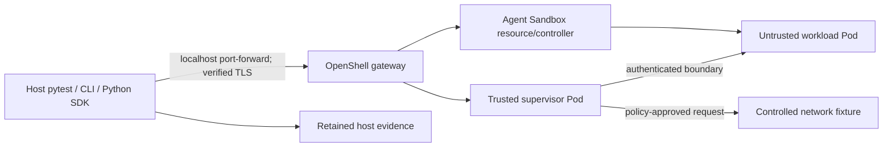

# OpenShell qualification in kind

Status: the initial kind/Calico bootstrap and independent network tests are implemented and passed on two clean clusters with confirmed cleanup. See the [platform qualification record](qualification/network-platform.md) and [runbook](runbooks/local-platform.md). Actual storage and OpenShell kernel/runtime admission remain within 1A; later slices below are planned. Source review uses OpenShell v0.1.2 documentation, but compatible immutable release artifacts must be selected and pinned before installation.

## Objective and scope

Establish a reproducible sandbox boundary with independently attributable failures before executing agents or repository vulnerability tests. The operator must distinguish Kubernetes admission/scheduling, OpenShell policy, gateway/transport, dependency resolution, toolchain/build, command execution, and cleanup failures.

Milestone 1 uses supported OpenShell commands, its Python SDK, Kubernetes/Helm tools, and pytest. It deploys one local gateway and permits one active qualification sandbox at a time. No model, Temporal workflow, issue-provider credentials, autonomous setup agent, custom runtime driver, policy advisor, custom graph engine, or generic check scheduler is needed.

Milestone 2 introduces the application Sandbox port and adapter after the native runtime is understood. Vendor-specific qualification tests remain useful independently of the application adapter. We reuse their fixtures and expected outcomes in later adapter tests, rather than routing the first diagnostic experiment through unqualified application code.

## Proposed directory structure

Only create files when a qualified slice needs them; do not scaffold empty packages for later components.

```text
corsair/
  README.md
  pyproject.toml                       Python 3.12; pytest/YAML now, SDK later
  uv.lock                             native Python dependency lock
  Makefile                            a few transparent command aliases
  .gitignore
  deploy/
    runtime-lock.yaml                 selected non-Python tool/chart/image tuple
    kind/
      cluster.yaml                    local topology; default CNI disabled
      bootstrap.py                    pinned native tools/up/down commands
    openshell/
      values.yaml                     shared official-chart overrides
      values-kind.yaml                isolated local access/storage differences
      values-cluster.example.yaml     operator-supplied namespace/auth/storage
    qualification/
      fixtures.yaml                   off-the-shelf echo endpoint and probe pods
      ingress.yaml                    selected-probe ingress allow
      egress-deny.yaml                selected-probe egress deny
      egress-allow.yaml               narrow additive egress allow
  policies/
    openshell/
      offline.yaml                    native policy for filesystem/exec checks
      qualification.yaml              narrowly allows controlled fixture traffic
      dependencies.yaml               explicit optional package-download profile
  images/
    qualification/
      Dockerfile                      trusted base, curl, synthetic canaries
    python-toolchain/
      Dockerfile                      pinned Python and pytest
    java-toolchain/
      Dockerfile                      pinned JDK 17, Maven, admitted JUnit fixture
  tests/
    qualification/
      conftest.py                     explicit local config, owned test fixtures
      support.py                      minimal argv command/receipt helpers
      test_network.py                 ordinary-pod CNI calibration (implemented)
      test_platform.py                readiness, CNI, admission, identity/mounts
      test_lifecycle.py               create/exec/transfer/delete and limits
      test_policy.py                  effective policy and allowed/denied access
      test_toolchains.py              known-good and deliberately broken builds
      test_recovery.py                disconnects, restart, evidence and cleanup
    fixtures/
      qualification/
        python-smoke/                 tiny trusted passing pytest project
        java-maven-smoke/             tiny trusted passing Maven/JUnit project
    configuration/                    offline isolation and evidence guard checks
  docs/
    openshell-milestone.md             this plan and acceptance requirements
    runbooks/
      openshell.md                    native setup and symptom-to-evidence steps
    qualification/
      openshell.md                    reviewed tuple, results, evidence references
  .github/workflows/
    openshell-qualification.yml        same commands on an admitted CI runner
  .runs/                              ignored execution evidence outside Git
  .state/                             ignored ownership/credential state
```

`pyproject.toml` and `uv.lock` own Python dependency versions. `runtime-lock.yaml` owns the selected non-Python tools and images, with its qualification scope stated explicitly. It currently pins kind/node, Kubernetes, Calico, and network fixtures. Add Agent Sandbox and OpenShell CLI/chart/gateway/supervisor/trusted-runtime pins when their slice begins. Selection is not evidence of a tested tuple. Scripts consume these selections without repeating version literals. Never use floating `latest`, a development alias, or unpinned release manifests for acceptance.

`deploy/openshell/` contains values for upstream charts, not copied chart templates. Local bootstrap installs the official Agent Sandbox controller/CRDs and a policy-enforcing CNI, then installs the official OpenShell chart. A Corsair worker chart belongs to a later milestone; it is not needed for this gateway-only deployment.

`policies/openshell/` contains native OpenShell YAML. Avoid a Corsair policy DSL, transformation engine, or automatic policy expansion. Keep preparation and execution authority explicit. The policies are operator-owned and immutable during a test. Record the effective policy and its source as well as the checked-in policy digest.

`tests/fixtures/qualification/` contains tiny trusted code for runtime readiness, not gold exploit answers. Real vulnerability candidates stay in `benchmarks/`; reviewed agent evaluation inputs/labels are introduced under `evals/` later.

`.runs/` can contain a run directory with JUnit XML, version/config manifest, per-check receipts, bounded stdout/stderr, SDK errors, Kubernetes events and resource metadata, OpenShell observations, timestamps, and cleanup evidence. Certificates, bearer tokens, kubeconfigs, environments containing secrets, and unredacted Kubernetes Secret objects do not belong in it or Git. Configure CLI registration and transport credentials in supported external state locations.

The implemented local bootstrap keeps its explicit kubeconfig and ownership receipt in `.state/kind/`, outside execution evidence. Automatic failed-bootstrap diagnostics collect scoped native kubelet/containerd journals; they do not dump Docker environments or Kubernetes Secrets. Full manual vendor diagnostic exports require review before sharing.

## Runtime topology and ownership

Use an explicitly named kind cluster and a pinned Calico installation as the initial local CNI candidate. Verify the selected Calico/kind/Kubernetes tuple rather than assuming compatibility. Default kind networking alone is insufficient evidence of NetworkPolicy enforcement.



Cluster-owned prerequisites are the CNI, Agent Sandbox CRDs/controller, required cluster RBAC, supported node kernel/runtime, and storage. Corsair-owned namespace resources are the gateway and its supported sandbox prerequisites. Start with one shared sandbox namespace using the upstream chart's supported shared mode. Separate gateway/workspace releases can be introduced when an existing cluster's namespace ownership requires them; do not begin with automatic per-investigation namespace management.

Readiness requires the selected node's actual Landlock/seccomp/task-memory facilities, not only a Linux version string. Docker Desktop and kind use the node/VM kernel, which may differ from the workstation. Require filesystem policy `landlock.compatibility: hard_requirement` and pass the upstream runtime's admission checks. A more permissive profile is not a repair for missing isolation prerequisites.

Workload images are standard approved OCI images. Kubernetes supplies OpenShell's trusted runtime separately. Do not bake a copied supervisor into application images or give workloads Docker sockets/host mounts to build arbitrary images. Fixed toolchain images contain only what a qualification slice needs.

For kind, use supported local-development user authentication with a localhost-bound port-forward, verified gateway TLS, and network restrictions that prevent workloads reaching the user API. If choosing upstream `server.auth.allowUnauthenticatedUsers` for this isolated profile, make that explicit and local-only; do not confuse TLS certificates with user authorization. Production values require the operator's supported OIDC or trusted proxy authentication. Production authentication is qualified separately before namespace deployment; local access does not qualify production tenancy.

Workloads receive no repository/provider/cloud/model credentials or workload-accessible Kubernetes API token. Supervisors retain the projected identity required by OpenShell. Inspect actual generated pods and mounts; do not globally remove the supervisor's required authentication mount. The chart/driver, rather than Corsair, owns creation of its runtime resources.

## Implementation slices and testing

Each slice has its own pytest marker and evidence. Provisioning remains explicit; pytest does not secretly create clusters. A failed prerequisite blocks dependent checks and appears as a qualification infrastructure failure, never as a successful safety test.

| Slice | Checks | Required evidence and gate |
| --- | --- | --- |
| 1A Host and platform | Tools, pinned architecture/node image, storage, actual runtime admission, native CNI probe allow/deny | Known reachable endpoint responds from trusted probe; forbidden ingress/egress from controlled probe pods never reaches it; allow rule succeeds. Resource presence alone cannot pass |
| 1B Gateway and identity | Chart readiness, SDK/CLI health, TLS trust, local access isolation, image pulls, actual pod identities/mounts | Matching versions; native readiness probes; observed caller/supervisor/workload boundaries. Distinguish certificate/auth failures from gateway availability |
| 1C Lifecycle and execution | Create with explicit workspace/name, wait ready, command output/exit, read/write/transfer roundtrip, delete and wait | Exact stdout/stderr and nonzero exit preserved; file digest matches; immutable sandbox identity retained; deletion confirmed for that identity |
| 1D Policy boundary | Effective policy, allowed/denied file operations, symlink escape, allowed endpoint, absent rule, denied HTTP method, literal-IP attempt | Same reachable fixture/operation succeeds under admitted rule and is denied under narrower rule; upstream receives no denied request. Missing observations fail evidence coverage |
| 1E Toolchains | Python import/pytest; Java compiler/Maven/JUnit; deliberate syntax failure; missing artifact and unavailable registry | Successful known-good build and discovered executed test; each deliberate failure names its layer. Prewarmed offline builds and cold dependency installs are reported separately |
| 1F Interruptions and limits | Execution timeout, lost client connection, gateway restart, bounded output, small bounded OOM test, repeated create/cleanup | No blind repeat of potentially executed commands; incomplete results stay unknown; external evidence survives restart; no surviving process after confirmed teardown; cleanup confirmed or visibly unconfirmed |

### Make boundary tests distinguishable

Use an off-the-shelf pinned local HTTP echo service instead of writing another network service. Before policy checks, confirm from a trusted probe that the endpoint and both tested methods actually work. Give every request a unique harmless marker. Narrowly allow its exact hostname/port and resolved private addresses through supported endpoint policy fields; no wildcard/private-subnet business-network access is needed. Validate the selected release's private-address/SSRF rules and DNS behavior.

Test OpenShell request restrictions with `enforcement: enforce`; the documented default `audit` can allow a request while logging a violation. Verify the binary real path and inherited executable matching rather than assuming that `pip`, `mvn`, or a shell wrapper is the connecting executable. Test with no attached providers, and inspect global policy and effective provider contributions so hidden rule precedence cannot invalidate the experiment.

Independent ordinary-pod CNI calibration establishes Kubernetes enforcement. An intercepted curl denial inside OpenShell establishes the supervisor/runtime check; that result alone does not prove the CNI would block a bypass. Inspect OpenShell's generated NetworkPolicies and attempt the relevant direct destination paths within the admitted workload environment. Treat those observations together, without claiming a general sandbox-escape proof.

For filesystem checks, bake a harmless world-readable canary outside the permitted workspace into the qualification image. Establish its existence and ordinary DAC permissions from trusted image preparation, then attempt access under the restricted policy. Exercise a symlink from allowed scratch space to that canary. A missing file or normal Unix permission error cannot stand in for filesystem policy evidence. Landlock denial may not produce an OpenShell event; retain the controlled setup, policy/admission facts, and actual operation result, and qualify the resulting attribution rather than promising universal per-access logging.

Check workload confinement, not arbitrary host paths or real secrets. Do not turn broad `/proc` access or policy weakening into a workaround for a failed test.

### Separate command execution from client delivery

An SDK RPC deadline, interrupted local pytest process, and remote command timeout are different events. A lost client can leave a command running. OpenShell error details and an exit code such as 124 do not alone establish whether the process tree was killed. After a timeout/interruption, inspect the native sandbox state and supported execution observations; then destroy the owned sandbox and confirm deletion. If a result cannot be reconstructed, report it as unknown and preserve that limitation.

Use the SDK's deletion acknowledgment and `wait_deleted(..., expected_sandbox_id=...)` so a reused human-readable name cannot make cleanup delete or misidentify a replacement. Verify resource deletion at the supported level and inventory attributable leftovers, including PVC retention. Record expected persistence separately from orphans; do not delete all resources in a shared namespace.

Kill only a bounded synthetic process tree and use explicitly small sandbox resource limits for the OOM fixture. Observe Kubernetes termination/resource facts and supervisor/gateway evidence. A workload's allocation error is not automatically evidence of a kernel OOM kill. CPU requests/limits and actual resource enforcement require admission and measured observations; scheduling delay and throttling are separate from application latency.

Native CLI transfers are the first transfer path. The inspected Python `SandboxClient` exposes lifecycle, execution, and waits, but no curated upload/download methods. Record that gap rather than inventing a broad SDK wrapper. Milestone 2 can use the supported CLI transfer surface or an admitted upstream transfer interface behind its narrow adapter. Never silently fall back to arbitrary `kubectl exec/cp` for production workload access.

### Toolchain qualification

Use a tiny pinned Python/pytest fixture and a tiny JDK 17/Maven/JUnit fixture. A version command alone does not qualify a build or prove test discovery. Require the expected test identifier/count and retained native output. First use preinstalled dependencies or an admitted warmed cache; then separately allow a small pinned dependency install to exercise network and package-resolution diagnostics.

A policy-denied download needs denial evidence. A permitted request returning a registry 404, package resolver conflict, or TLS error retains that upstream response/error and must not be classified as policy denial. Keep Java compilation errors, Maven resolution/plugin errors, test-discovery failures, and assertion failures distinct. These checks use trusted projects; historical Vul4J projects enter only after their actual runtime profiles are admitted.

## Test tooling and operator commands

Use pytest fixtures, markers, parameterization, ordinary assertions, and JUnit XML. Use native SDK errors and results, Helm/Kubernetes readiness, and existing OpenShell logs/metrics. A small standard-library argv subprocess helper is enough for native CLI checks; it passes explicit argument arrays, bounded timeouts, and captures exit/output. Do not add a second check engine or a custom event bus.

Implemented commands for the initial platform subset:

```shell
make tools
make test-config
make kind-up
make qualify-network CORSAIR_QUAL_RUN=.runs/local-network-001
make kind-down
```

This qualifies ordinary-pod CNI behavior only after the live tests pass. The remaining 1A prerequisite/storage/native-kernel slice is also implemented and has a separate [qualification report](qualification/openshell-admission.md) and [runbook](runbooks/openshell-admission.md):

```shell
make admission-artifacts
make test-config
make kind-up
make admission-install
make qualify-admission CORSAIR_QUAL_RUN=.runs/admission-001
make kind-down
```

These commands do not install a gateway or qualify the authenticated boundary service. Illustrative commands for later slices, to implement one at a time:

```shell
CORSAIR_QUAL_RUN=.runs/local-001
mkdir -p "$CORSAIR_QUAL_RUN"
make kind-up
make openshell-install
uv run pytest tests/qualification -m platform --junitxml="$CORSAIR_QUAL_RUN/platform.xml"
uv run pytest tests/qualification -m lifecycle --junitxml="$CORSAIR_QUAL_RUN/lifecycle.xml"
uv run pytest tests/qualification -m policy --junitxml="$CORSAIR_QUAL_RUN/policy.xml"
uv run pytest tests/qualification -m toolchain --junitxml="$CORSAIR_QUAL_RUN/toolchain.xml"
uv run pytest tests/qualification -m recovery --junitxml="$CORSAIR_QUAL_RUN/recovery.xml"
make kind-down
```

The run directory is operator-selected and created explicitly. The full qualification target runs the admitted groups in dependency order and preserves failing results. It does not skip failed prerequisite checks into an apparent pass. Live qualification CI executes the same commands on a runner that has passed actual kernel/container qualification; a standard hosted runner is not assumed compatible. Add live qualification CI only when the first live slice passes locally. Offline development/record guards run independently in the development workflow and do not qualify the runtime.

The later `corsair doctor sandbox` entry point can call admitted checks through a small diagnostic seam. It should not spawn pytest as part of an investigation, import pytest into the production worker, or become another scheduler. Production health checks are a deliberately limited subset; destructive qualification fixtures stay operator tests.

Use three test frequencies. Fast configuration checks validate YAML, locked selections, and official Helm rendering on every configuration change; offline rendering may disable only the chart's discovery preflight, without changing the live install profile. Live lifecycle/policy/toolchain checks run when the corresponding boundary changes and at milestone acceptance. Destructive restart, interruption, resource-limit, and fresh-cluster tests run explicitly and on an admitted scheduled/release runner. Fast checks do not qualify live enforcement. Add focused unit tests only when Corsair introduces actual translation/evidence logic during the adapter milestone; do not recreate upstream SDK tests or mock a boundary into a pass.

## Diagnostic evidence and metrics

A check receipt records check/run/operation identity, configuration and image/policy digests, workspace and sandbox UUID, start/end timestamps, outcome, observed failure layer, SDK/gRPC code and structured reason when available, process exit/result completeness, evidence references, and cleanup result. Preserve upstream details and represent absent details explicitly. A wrapper's exception class or a timeout alone cannot infer a policy denial.

Use check outcomes `passed`, `failed`, `blocked`, and `unsupported`; record remote command outcome independently as completed, failed, or unknown. A test can pass by correctly demonstrating a command failure or denial. The qualification gate treats any unsupported mandatory boundary as non-qualified. This diagnostic schema is small domain evidence, not a new telemetry framework.

Record wall/queue/readiness/command/download/cleanup times where observable, output bytes/truncation, resource requests/limits and terminations, and native SDK/CLI retry attempts. Keep unobservable values unknown. Model calls, tokens, and agent retries are not measured until agents exist. Local qualification can use JUnit timings and structured receipts; the later worker uses native OpenTelemetry. No hosted telemetry account is required.

The gateway's in-memory log buffer is bounded and disappears on restart. Watch streams can report loss. Collect the evidence required for each check into host-owned files before destructive teardown, and use supported structured export/collection when available. Do not rely on workload-editable files as authoritative evidence. Gateway/supervisor/Kubernetes observations and test-controller receipts establish authority. Missing expected evidence makes that check incomplete; log absence is not proof of denial or safety.

Do not equate OpenShell anonymous product telemetry with Corsair observability. Disable optional product telemetry in the initial profile if desired, while retaining operational logs and required qualification evidence.

## Milestone acceptance and handoff

All admitted required checks must pass on a fresh cluster and after a second clean creation. Require three clean lifecycle/policy repetitions in fresh sandboxes as an initial reproducibility check. Preserve timings and every failure; these small counts do not establish reliability at fleet scale or absence of all escapes.

The reviewed report contains the tested version/kernel/runtime tuple, actual policy enforcement evidence, allowed/denied matrices, native test discovery, interruption and cleanup results, remaining SDK gaps, and supported limits. Any required kernel/CNI/control-plane isolation gap blocks the milestone. Optional external registry probes do not obscure the local deterministic suite's result, and the report states exactly which dependency paths were admitted.

Deliver the repeatable setup, qualification tests, runbook, and evidence report. Then implement the narrow Sandbox port in `src/corsair/ports/sandbox.py` and its SDK-backed adapter in `src/corsair/adapters/openshell.py` during Milestone 2. Keep domain contracts under `src/corsair/core/`; vendor objects stay inside the adapter. The app does not import the qualification tests or gain cluster-admin tooling merely because the operator tests use kubectl.

## Upstream references

- [Kubernetes setup](https://github.com/NVIDIA/OpenShell/blob/v0.1.2/docs/kubernetes/setup.mdx): official charts, Agent Sandbox prerequisites, network enforcement, split ownership.
- [Support matrix](https://github.com/NVIDIA/OpenShell/blob/v0.1.2/docs/about/support-matrix.mdx): actual kernel/runtime admission requirements.
- [Python SDK](https://github.com/NVIDIA/OpenShell/blob/v0.1.2/docs/sdk/python.mdx) and [implementation](https://github.com/NVIDIA/OpenShell/blob/v0.1.2/python/openshell/sandbox.py): explicit workspaces, execution, lifecycle and identity-aware waits.
- [Sandbox commands](https://github.com/NVIDIA/OpenShell/blob/v0.1.2/docs/how-it-works/sandboxes/overview.mdx): create, exec, limits, transfers and lifecycle semantics.
- [Policy schema](https://github.com/NVIDIA/OpenShell/blob/v0.1.2/docs/how-it-works/policies/schema.mdx) and [network rules](https://github.com/NVIDIA/OpenShell/blob/v0.1.2/docs/how-it-works/policies/network-rules.mdx): fail-closed filesystem compatibility, request enforcement and binary matching.
- [Access control](https://github.com/NVIDIA/OpenShell/blob/v0.1.2/docs/kubernetes/access-control.mdx): local access, OIDC and supervisor/workload identity.
- [SDK errors](https://github.com/NVIDIA/OpenShell/blob/v0.1.2/docs/sdk/api-errors.mdx): structured diagnostic details, uncertain delivery and cleanup acknowledgment.
- [Log access](https://github.com/NVIDIA/OpenShell/blob/v0.1.2/docs/observability/accessing-logs.mdx) and [structured export](https://github.com/NVIDIA/OpenShell/blob/v0.1.2/docs/observability/ocsf-json-export.mdx): buffer retention and loss-aware evidence collection.
